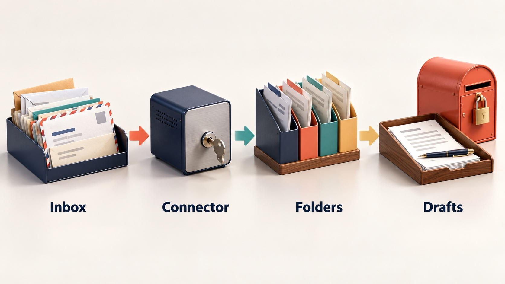
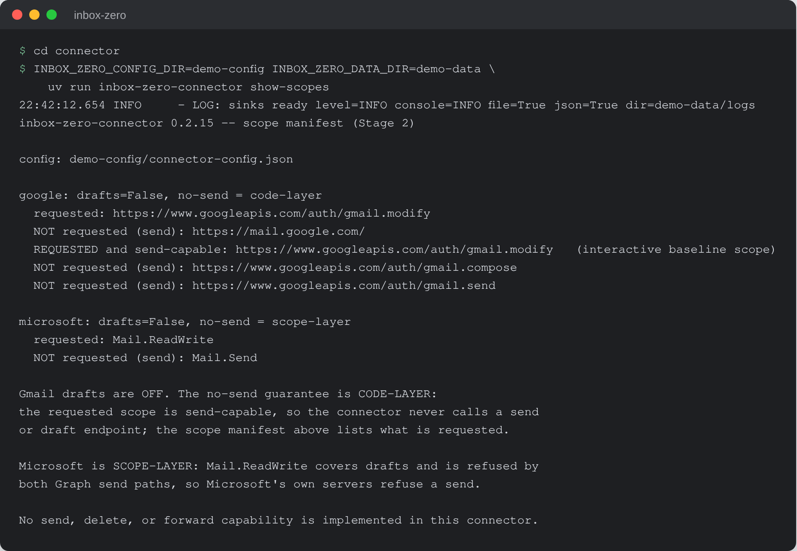

# Inbox Zero

Email triage and reply drafting for small businesses, built around a local MCP
connector that can read, file, flag and draft, and has no way to send.


## What it is

Inbox Zero sweeps a Gmail or Microsoft 365 inbox, sorts each thread into a short
list of folders the owner chose, flags the few that need a person today, and
writes a short digest of what it did. For threads that need an answer, it
writes a first draft in the owner's own voice and leaves it in the Drafts
folder.

Every action is a move, a flag or a draft. Nothing is deleted. Every action is
written to an append-only ledger, and any filing can be undone from that
ledger. The owner still reads, edits and sends every message that goes out.

## Why it exists

A small-business inbox mixes client work, vendor invoices, notices and
newsletters. Sorting it and starting replies from a blank box takes time away
from the messages that actually need the owner. Most AI mail tools ask for
broad mailbox access, including send, and offer a promise in place of a control
an IT person can check. Inbox Zero gives the owner back that time while keeping
every outgoing message in their hands, and states exactly which permission
layer enforces that.

## How it works



The kit is a set of markdown skills (`inbox-triage`, `voice-profile`,
`draft-replies`) plus a self-adapting `installer.md` that any host AI reads to
install the kit for its own platform. The skills drive a local MCP server, the
connector in `connector/`, which runs on the owner's machine with the owner's
own OAuth grant. The host AI decides which message goes where and writes the
words of a reply. The connector performs every mailbox action through the
Gmail API or Microsoft Graph, validates each filing against a closed folder
list, picks the voice from a fixed rule table, and writes the ledger row itself
as a side effect of each successful action. The AI never calls a mail API and
has no tool to write or skip the ledger.

## Features

- Ten MCP tools: list and survey the inbox, read a thread, read a sent-mail
  sample the owner selected, look up voice routing, file a message, record a
  correction, mark important, create a draft, and read the daily digest. There
  is no send, delete or forward tool, and a draft cannot be addressed to anyone
  not already on the thread.
- Closed folder list: the AI can only file into folders configured at install,
  so a hostile email's worst case is misfiling itself. Instructions found
  inside an email are quoted back in the digest and acted on by nobody.
- Ledger and undo: one row per action, never edited; an undo is a new row.
  "Undo that last one" and "undo the whole sweep" replay the ledger.
- Mailbox scope: Inbox only, everything, everything except named folders, or
  only named folders. Exclusions cover subfolders and are matched without
  regard to case.
- Uncertain items go to Action Needed and are listed in the digest with the
  reason.
- Voice profile: built only from sent mail the owner points at, written as a
  page of patterns with no quoted sentences, client names or figures, and used
  only after the owner reviews it.
- Missing-fact gate: if a reply needs a price, date or decision the owner has
  not given, drafting stops and asks. A hedged answer ("about nine grand") is
  refused too.
- No-send enforcement stated per provider. On Microsoft 365 it is the
  permission layer: the connector requests `Mail.ReadWrite`, which Graph's send
  API does not accept. On Gmail it is the code layer: the consent flow grants
  `gmail.modify`, and the connector contains no send code path. The
  `show-scopes` command prints the live manifest for the installed config.
- Two build tiers from one codebase: `basic` (filing only, voice module not
  shipped) and `enhanced` (adds voice profile and reply drafts). Zip contents
  are decided by `connector/scripts/packaging/tiers.json` and checked by a
  packaging judge.

## Run it locally (for review)

Requires [uv](https://docs.astral.sh/uv/); uv installs Python 3.14 if needed.

```sh
git clone https://github.com/rodaddy/inbox-zero.git
cd inbox-zero/connector

uv sync
uv run pytest -q

# Print the OAuth scope manifest and no-send posture (offline, no sign-in)
INBOX_ZERO_CONFIG_DIR=demo-config INBOX_ZERO_DATA_DIR=demo-data \
  uv run inbox-zero-connector show-scopes

# Every subcommand
uv run inbox-zero-connector --help
```



*`show-scopes` on a fresh config: what the connector asks Google and Microsoft
for, which send-capable scopes it does not request, and which layer enforces
no-send on each provider.*

Connecting a real mailbox follows `connector/INSTALL-RUNBOOK.md`
(`install.sh` on macOS and Linux, `install.ps1` on Windows). To use the kit
itself, open `START-HERE.md` in your AI assistant.

**Licence:** free for personal and non-commercial use with credit; commercial
use needs a licence. See [LICENSE](LICENSE) (PolyForm Noncommercial 1.0.0) or
contact rico@rtech-consulting.com.

## Stack

- Python 3.14, packaged with uv (`connector/pyproject.toml`, `uv.lock`)
- MCP Python SDK (`mcp>=2`)
- Gmail API (`google-api-python-client`, `google-auth-oauthlib`) and Microsoft
  Graph (`msal`, `httpx`)
- pydantic and pydantic-settings for models and layered config, loguru for
  logging, tenacity for retries, keyring for tokens
- pytest suite under `connector/tests/`

## Repository layout

- `connector/`: the MCP server, its tests, packaging scripts and install docs
- `skills/`: `inbox-triage`, `voice-profile`, `draft-replies` skill contracts
  and workflows
- `installer.md`, `START-HERE.md`: the self-adapting kit installer
- `OPERATIONS-MANUAL.md`: day-to-day operation: sweep, digest, undo, voice,
  drafts
- `docs/`: spec, runbooks, capability map and design analyses
- `examples/`: five worked examples on invented data
- `tiers/`: what each build tier contains

## How it was built

The kit was specified and its first connector built on 2026-08-17, with a
scripted no-send check written to fail first. Six review rounds with
different reviewer roles followed the same day, then a watcher, packaging,
pilot installs and a voice stage through September 2026. The test suite grew
from 84 to 2,718 tests, and a live token-expiry soak was turned into an
in-process test that runs on every build. The full account is in
[docs/BUILD-STORY.md](docs/BUILD-STORY.md).

## Project status

Active, beta. Connector version 0.2.15. Proven against live mailboxes: Gmail
end to end (sign-in, watch pass, filing, receipts) on 2026-08-18, and Microsoft
365 sign-in plus a read pass against a live tenant on 2026-08-23. Not yet
proven: a clean-room install by someone who has never seen the repo, and
Microsoft 365 filing end to end on a customer tenant. The kit packaging around
the connector (skills, installer, tier notes) has not been clean-room
installed.

## Credits

Built on the [Model Context Protocol](https://modelcontextprotocol.io) Python
SDK, Google's API client libraries, Microsoft's MSAL, pydantic, loguru,
tenacity and keyring.

## Author

Rico Rojas, https://rico-rojas.com
